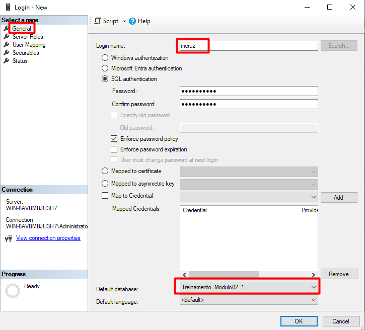
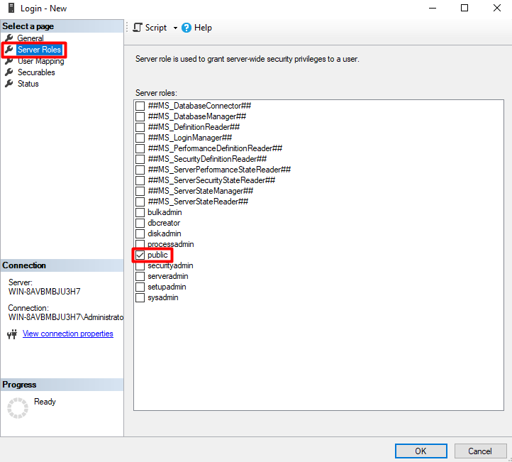
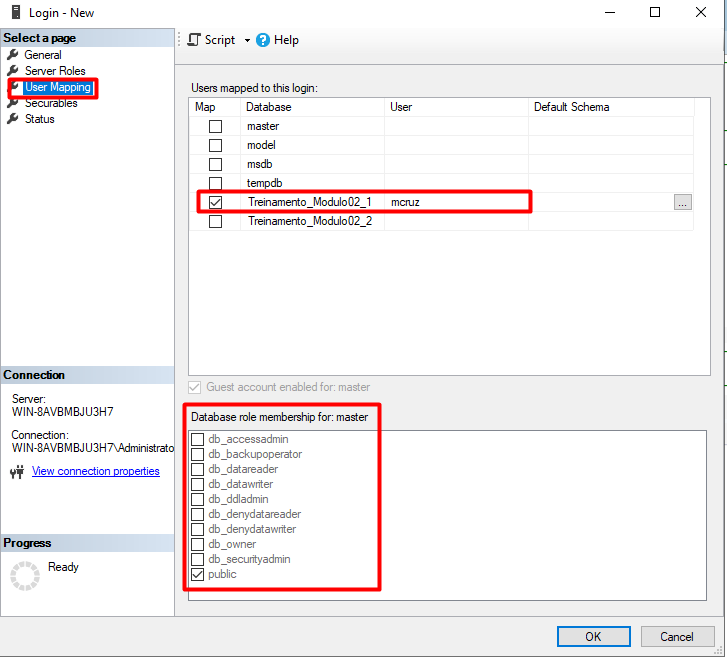
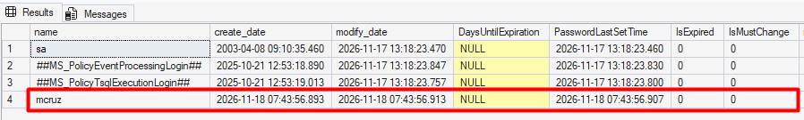
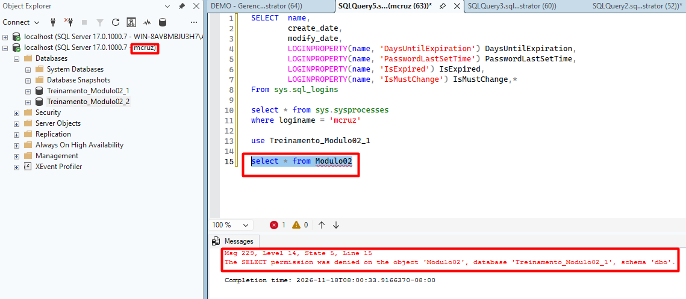

# Lab 02 — SQL Server Security & Access Management

> **Status:** In Progress — Part 1: SQL login, database user mapping, and table-level SELECT permission.

## 1. Objective

Create a SQL Server-authenticated login, map it to a database user, and validate the principle of least privilege by testing access to a table before and after granting a specific permission.

This is a hands-on learning laboratory based on the *Tarefas do Dia a Dia de um DBA* course from Power Tuning, supplemented by Microsoft documentation and independent testing.

## 2. Laboratory Environment

| Component | Configuration |
|---|---|
| Virtualisation | Oracle VirtualBox |
| Operating system | Windows Server 2022 |
| Database engine | SQL Server Developer Edition |
| Administration | SQL Server Management Studio (SSMS) |
| Lab server | SQL01 |
| Authentication used in this exercise | SQL Server Authentication |

**Lab objects:**

- `Treinamento_Modulo02_1` — database used for login mapping and permission testing.
- `Treinamento_Modulo02_2` — second lab database created for later access scenarios.
- `mcruz` — example SQL Server login and database user.
- `dbo.Modulo02` — existing lab table with sample rows used to test `SELECT` access.

> The scripts and database names in this repository are for an isolated learning environment. No real passwords are included.

## 3. Implementation

### Step 1 — Prepare the lab databases

Two training databases were created. The [database setup script](scripts/01-create-lab-databases.sql) demonstrates a non-destructive way to create them if they do not already exist.

### Step 2 — Create a SQL Server login

In SSMS, I created the SQL-authenticated login `mcruz` and selected `Treinamento_Modulo02_1` as its default database. Password policy enforcement was enabled in the configuration shown; password expiration was not enabled in this particular lab.



The default database determines the initial database context after login. It does **not** by itself grant access to that database.

### Step 3 — Review server-level roles

The login was not assigned elevated fixed server roles. The `public` role was the only role checked in the captured configuration.



### Step 4 — Map the login to a database user

I mapped `mcruz` to a database user in `Treinamento_Modulo02_1`. I did not select `Treinamento_Modulo02_2` in the screenshot.



The [user mapping script](scripts/02-map-login-to-database-user.sql) shows the corresponding T-SQL step. The database user and server login are related but are distinct security principals.

### Step 5 — Verify login creation

I queried SQL Server login metadata to confirm the new login appeared in `sys.sql_logins`.



The query is included in the [login verification script](scripts/03-check-login.sql).

## 4. Permission Validation

### Before granting permission

When connected as `mcruz`, I attempted to read `dbo.Modulo02` in `Treinamento_Modulo02_1`.

```sql
USE [Treinamento_Modulo02_1];
GO

SELECT * FROM dbo.Modulo02;
```

**Observed result:** SQL Server returned error **229**, indicating that `SELECT` permission was denied on the table.



### Grant table-level permission

Using an account authorized to manage permissions, I granted only `SELECT` access to the database user:

```sql
USE [Treinamento_Modulo02_1];
GO

GRANT SELECT ON OBJECT::dbo.Modulo02 TO [mcruz];
GO
```

The statement is also saved in [the permission grant script](scripts/04-grant-select.sql).

### After granting permission

I repeated the `SELECT` while connected as `mcruz`.

**Observed result:** the query succeeded and returned sample table rows. This demonstrates the change in effective access for this exercise.


The [access test script](scripts/05-test-select-as-login.sql) can be executed before and after the grant to reproduce the comparison.

## 5. Results

| Test | Observed result |
|---|---|
| Create SQL-authenticated login | Login appeared in server metadata |
| Map login to database | User mapping shown for `Treinamento_Modulo02_1` |
| Read `dbo.Modulo02` before permission grant | Permission denied — error 229 |
| Grant `SELECT` on `dbo.Modulo02` | Permission grant performed in the exercise |
| Read `dbo.Modulo02` after permission grant | Query succeeded and returned rows |

## 6. Lessons Learned

- A **login** authenticates a principal to the SQL Server instance, while a **database user** represents that principal within a database.
- Selecting a default database is different from mapping a login to a database user.
- Fixed server roles and database-level permissions have different scopes.
- A permission error can be validated before granting the minimum access required.
- A targeted `GRANT SELECT` allows table reads without adding the user to broad database roles such as `db_owner`.

## 7. Next Steps

- Validate access restrictions in the second database.
- Explore database roles and membership.
- Test `REVOKE` and `DENY` with documented expected results.
- Compare permissions granted directly to a user and through a role.
- Review SQL Server authentication and password management best practices.

## 8. Security Notes

- No real passwords, authentication secrets, or connection strings are stored in this repository.
- The login shown is used only in an isolated lab environment.
- Example setup scripts **do not drop existing databases**.
- Screenshots show a lab username and machine information. Review them before public publication.

## 9. References

- [Microsoft Learn — CREATE LOGIN](https://learn.microsoft.com/en-us/sql/t-sql/statements/create-login-transact-sql)
- [Microsoft Learn — GRANT Object Permissions](https://learn.microsoft.com/en-us/sql/t-sql/statements/grant-object-permissions-transact-sql)
- [Microsoft Learn — Configure Permissions on Database Objects](https://learn.microsoft.com/en-us/sql/t-sql/lesson-2-configuring-permissions-on-database-objects)
- [Power Tuning — Tarefas do Dia a Dia de um DBA](https://cursos.powertuning.com.br/course/tarefas-do-dia-a-dia-de-um-dba)

*This repository contains personal study notes and independent laboratory work; it is not an official Power Tuning course repository.*
