# Lab 02 — SQL Server Security & Access Management

> **Course module:** Completed  
> **GitHub lab:** Documented — revised scripts still require a complete clean-environment retest.

## 1. Objective

Practice SQL Server login creation, user mapping, authentication and object-level permissions. The lab demonstrates how access changes after `GRANT`, `DENY`, and `REVOKE`, including tests with tables, table-valued functions, views, stored procedures and queries across databases.

These are my study exercises from [Power Tuning — *Tarefas do Dia a Dia de um DBA*](https://cursos.powertuning.com.br/course/tarefas-do-dia-a-dia-de-um-dba), supplemented with Microsoft documentation. Screenshots show the original SSMS exercises; repository scripts have been reorganised and, where needed, adapted for safer reuse.

## 2. Laboratory Environment

| Component | Technology |
|---|---|
| Virtualisation | Oracle VirtualBox |
| Operating System | Windows Server 2022 |
| Database Engine | SQL Server Developer Edition |
| Management Tool | SQL Server Management Studio (SSMS) |
| Server | SQL01 |
| Authentication | SQL Server Authentication |
| Login used for access tests | `mcruz` |
| Databases | `Treinamento_Modulo02_1` and `Treinamento_Modulo02_2` |

**Accounts:** Keep two SSMS connections available: one authorised to administer the lab and a second connected as `mcruz`. Never run permission tests using an administrator connection when the goal is to verify restricted access.

## 3. Implementation — Step by Step

### Step 1 — Prepare the training databases and sample objects

I created two databases for the access tests. The sample objects let another learner repeat the exercise using fictitious data.

- [01 — Create lab databases](scripts/01-create-lab-databases.sql) *(previously published)*
- [01a — Create sample tables and rows](scripts/01a-create-demo-objects.sql) *(new)*

The setup files avoid deleting existing databases or rows.

### Step 2 — Create the SQL Server login

Using **Security → Logins → New Login** in SSMS, I created `mcruz` with SQL Server Authentication and selected `Treinamento_Modulo02_1` as the default database. Password policy enforcement was enabled; password expiration was not enabled for this exercise.

The password is **not** included in the repository. For a fresh lab run, create the login manually with a new, strong password.

### Step 3 — Review server roles

I reviewed the login's fixed server roles and left only the default `public` role, without elevated server-level roles.

### Step 4 — Map the login to a database user

I mapped the server login to a database user in `Treinamento_Modulo02_1`. A login and a database user are distinct principals; choosing a default database does not itself grant data access.

- [02 — Map login to database user](scripts/02-map-login-to-database-user.sql) *(previously published)*

### Step 5 — Verify login metadata

I queried `sys.sql_logins` to verify that the login was created and to inspect its policy settings.

- [03 — Check login metadata](scripts/03-check-login.sql) *(previously published)*

### Step 6 — Test table access before and after GRANT

When connected as `mcruz`, a `SELECT` from `dbo.Modulo02` initially returned error **229** (permission denied). I then granted a targeted `SELECT` permission and repeated the query successfully.

- [05 — Test SELECT as restricted login](scripts/05-test-select-as-login.sql) *(test first)*
- [04 — Grant SELECT on sample table](scripts/04-grant-select.sql) *(run as administrator between the tests)*

**Before grant:**

**After grant:**

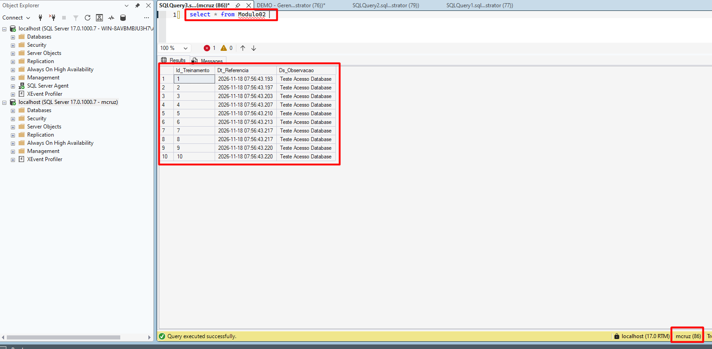

### Step 7 — Create and test a table-valued function

I created `dbo.fncModulo02(@Id)` and compared access before and after an object-level `GRANT SELECT`.

- [06 — Create function and view](scripts/06-create-function-and-view.sql)
- [07 — Grant SELECT on function and view](scripts/07-grant-function-and-view.sql)

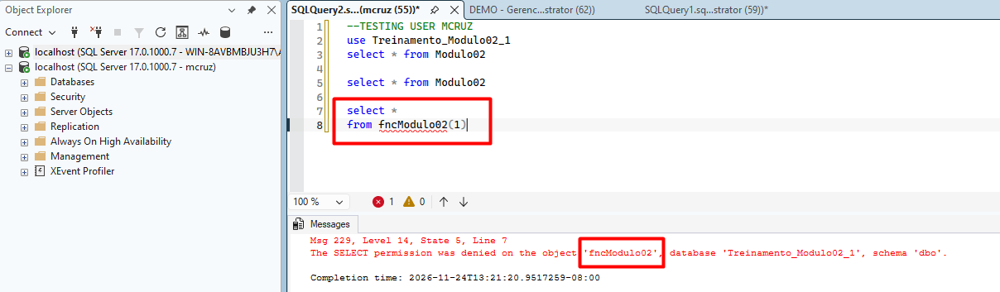
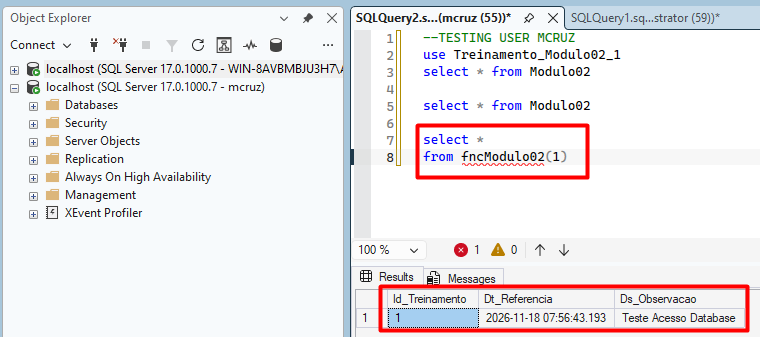

### Step 8 — Test SELECT permissions on a view

I created `dbo.vwModulo02` over the sample table and tested `SELECT` before and after a view-specific permission grant.

The same [creation](scripts/06-create-function-and-view.sql) and [permission](scripts/07-grant-function-and-view.sql) scripts contain the view exercise.

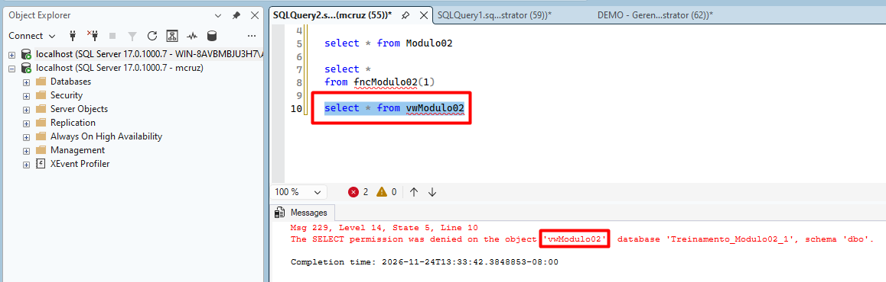
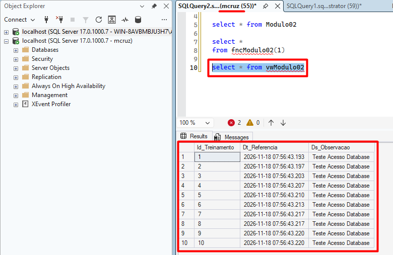

### Step 9 — Create and test stored procedures

I created `dbo.stpModulo02`, `dbo.stpModulo02_2` and `dbo.stpModulo02_3`. I tested an unauthorised `EXECUTE`, then granted access to a specific procedure.

- [08 — Create stored procedures](scripts/08-create-procedures.sql)
- [09 — Test EXECUTE grants and DENY](scripts/09-execute-grant-and-deny.sql)

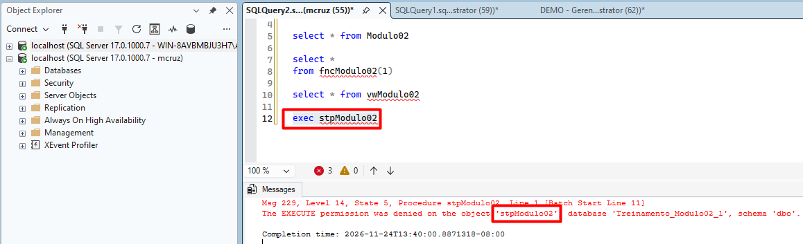
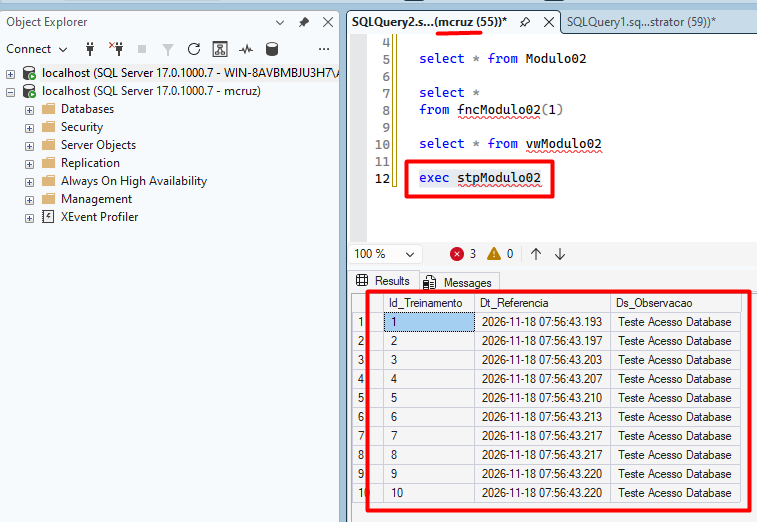

### Step 10 — Compare broad EXECUTE permission with object-level DENY

During the course, I explored a **database-wide** `GRANT EXECUTE` and a specific `DENY EXECUTE` on `dbo.stpModulo02_2` to compare how the permissions interact. The broad grant is **commented out** in the published script and is not a default security recommendation.

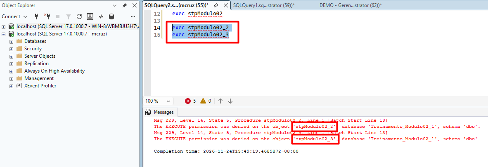
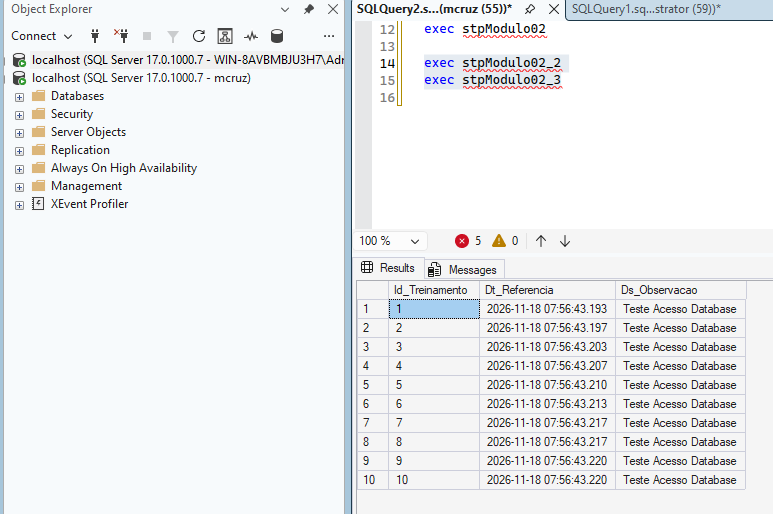

### Step 11 — Test cross-database access

I created `dbo.stpModulo02_4` in `Treinamento_Modulo02_1` to query a table in `Treinamento_Modulo02_2`. This illustrates how access can depend on user mapping, execution context and effective permissions in the target database.

- [10 — Create cross-database procedure](scripts/10-create-cross-database-procedure.sql)
- [11 — Map user and grant DB2 access](scripts/11-grant-cross-database-access.sql)

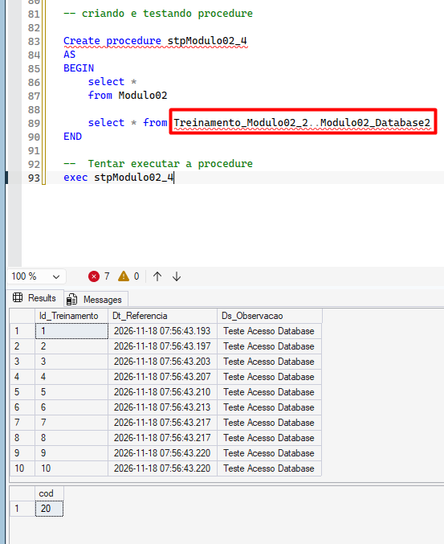
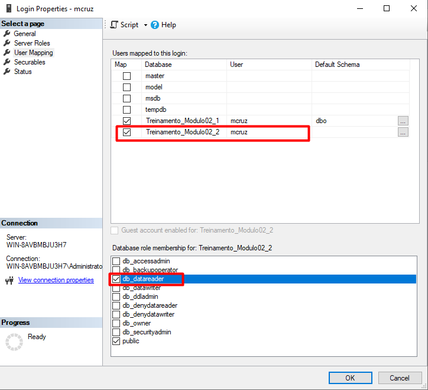

Do not enable `TRUSTWORTHY` or server-wide cross-database ownership chaining just to make the exercise run.

### Step 12 — Audit object permissions

I checked explicit permissions recorded for `mcruz` using `sys.database_permissions` and related catalog views.

- [12 — Audit object permissions](scripts/12-audit-object-permissions.sql)

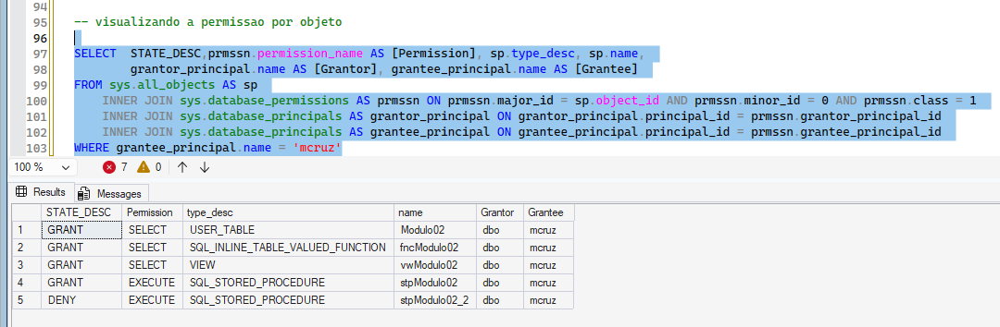

**Note:** Explicit permission rows do not, by themselves, represent the full set of effective permissions after roles and ownership chaining are taken into account.

### Step 13 — Test REVOKE and DENY on a table

I reviewed the difference between removing a permission entry with `REVOKE` and explicitly rejecting access with `DENY`. This changes the permission state and should be done **after** earlier tests.

- [13 — REVOKE and DENY comparison](scripts/13-revoke-and-deny-select.sql)

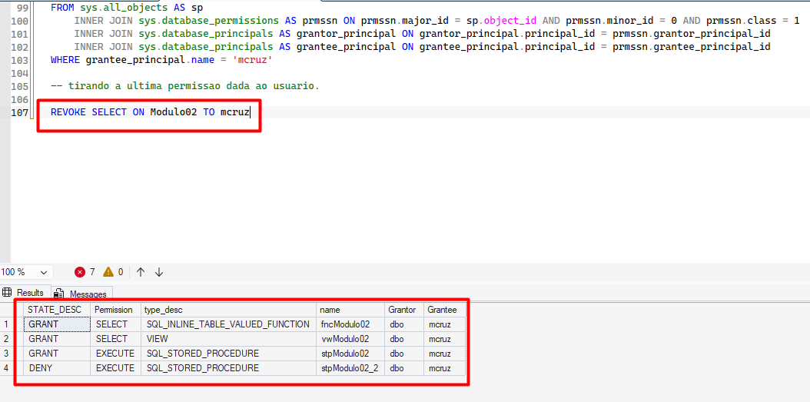
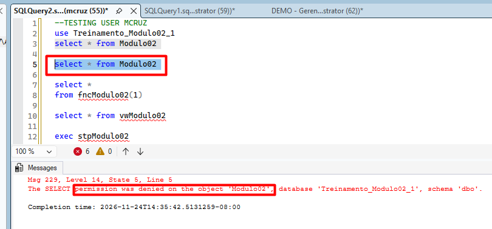
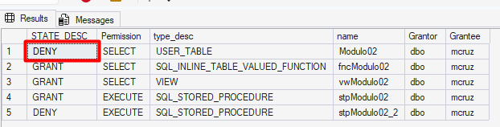

### Step 14 — Review sessions and cleanup dependencies

I inspected the difference between a server login and a database user when removing access. To modernise the earlier session query, the published script uses `sys.dm_exec_sessions` and does **not** terminate any sessions.

- [14 — Inspect login sessions](scripts/14-inspect-login-sessions.sql)
- [99 — Optional cleanup reference](scripts/99-cleanup-reference.sql)

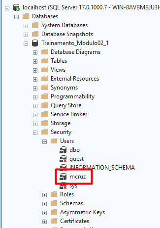

## 4. How to Reproduce This Lab

**Prerequisites:** SQL Server Developer Edition and SSMS in an isolated lab. Run as two separate connections: an administrator and the restricted login `mcruz`.

| Order | Action / script | Connection | Expected outcome |
|---|---|---|---|
| 1 | [01-create-lab-databases.sql](scripts/01-create-lab-databases.sql) | Administrator | DB1 and DB2 exist |
| 2 | [01a-create-demo-objects.sql](scripts/01a-create-demo-objects.sql) | Administrator | Sample tables and rows exist |
| 3 | Create `mcruz` login manually in SSMS | Administrator | Login can authenticate |
| 4 | [02-map-login-to-database-user.sql](scripts/02-map-login-to-database-user.sql), [03-check-login.sql](scripts/03-check-login.sql) | Administrator | User mapping and metadata confirmed |
| 5 | [05-test-select-as-login.sql](scripts/05-test-select-as-login.sql) | mcruz | `SELECT` denied before grant |
| 6 | [04-grant-select.sql](scripts/04-grant-select.sql), then repeat 05 | Administrator, then mcruz | `SELECT` returns rows |
| 7 | [06-create-function-and-view.sql](scripts/06-create-function-and-view.sql); test both SELECTs | Administrator, then mcruz | Initial access can be denied |
| 8 | [07-grant-function-and-view.sql](scripts/07-grant-function-and-view.sql); retest | Administrator, then mcruz | Function/view SELECT allowed |
| 9 | [08-create-procedures.sql](scripts/08-create-procedures.sql); test EXECUTE | Administrator, then mcruz | Missing EXECUTE permission demonstrated |
| 10 | [09-execute-grant-and-deny.sql](scripts/09-execute-grant-and-deny.sql); follow optional comments *only in test DB* | Administrator, then mcruz | Object GRANT; optional broader GRANT/DENY comparison |
| 11 | [10-create-cross-database-procedure.sql](scripts/10-create-cross-database-procedure.sql); test | Administrator, then mcruz | Access depends on permissions/context |
| 12 | [11-grant-cross-database-access.sql](scripts/11-grant-cross-database-access.sql); retest | Administrator, then mcruz | Target DB permission configured |
| 13 | [12-audit-object-permissions.sql](scripts/12-audit-object-permissions.sql) | Administrator | Explicit permissions listed |
| 14 | [13-revoke-and-deny-select.sql](scripts/13-revoke-and-deny-select.sql) | Administrator, then mcruz | Table access denied after DENY |
| 15 | [14-inspect-login-sessions.sql](scripts/14-inspect-login-sessions.sql) | Administrator | Login sessions inspected |
| 16 | [99-cleanup-reference.sql](scripts/99-cleanup-reference.sql) | Administrator | Review-only; destructive steps commented |

**Important:** Do not execute every script in a single run. To document *before/after*, pause between grants and retest as the restricted login. Some commands change permissions, so later reruns may produce different results unless the lab state is reset.

The screenshots document the course exercises. **The adapted scripts were not yet executed by me or verified as a complete fresh-install sequence**, so results from a new run must be recorded separately.

## 5. Results & Validation

| Area | Evidence recorded during the course |
|---|---|
| Login & user | Login created, mapped and inspected |
| Table `SELECT` | Denied (error 229), then allowed after a targeted GRANT |
| Function & view | Denied/allowed tests in SSMS screenshots |
| Procedures | EXECUTE permission tests with GRANT and DENY |
| Cross-database access | Procedure and target-user configuration documented; effective access depends on lab context |
| Permission auditing | Explicit permissions inspected before/after changes |
| Cleanup | Database user reviewed separately from server login |

## 6. Lessons Learned

- A server **login** authenticates to the instance; a database **user** represents the principal inside a particular database.
- A default database is not the same as database permission.
- `GRANT` adds permissions, `REVOKE` removes explicit permissions, and `DENY` explicitly blocks an operation, subject to SQL Server permission resolution rules.
- Object-specific grants usually provide tighter scope than database-wide permissions.
- Permissions on views, functions and procedures may interact with module ownership chaining; direct table access and module execution are not always equivalent.
- Cross-database access requires careful attention to target database mapping and security context.
- A reproducible lab needs setup scripts, expected results, and a cleanup plan.

## 7. Next Steps

- Retest the adapted scripts in a fresh VM/database to validate the full sequence.
- Extend the lab with role membership and `EXECUTE AS USER` permission checks.
- Apply the same documented step-by-step structure to the next Power Tuning module.

## 8. Security Notes

- No password, authentication secret or production connection string is intentionally included in this repository.
- Use a unique password for the example login; never commit screenshots showing credentials.
- All scripts target fictional lab databases. Do not run them against production.
- The broad database-level `GRANT EXECUTE` example is provided **commented out** to avoid accidental over-privileging.
- Review screenshots for machine names and other identifying data before publishing.
- The cleanup file does not run `DROP` or `KILL` commands automatically.

## 9. References

- [Microsoft Learn — CREATE LOGIN](https://learn.microsoft.com/en-us/sql/t-sql/statements/create-login-transact-sql)
- [Microsoft Learn — GRANT Object Permissions](https://learn.microsoft.com/en-us/sql/t-sql/statements/grant-object-permissions-transact-sql)
- [Microsoft Learn — REVOKE Object Permissions](https://learn.microsoft.com/en-us/sql/t-sql/statements/revoke-object-permissions-transact-sql)
- [Microsoft Learn — DENY Object Permissions](https://learn.microsoft.com/en-us/sql/t-sql/statements/deny-object-permissions-transact-sql)
- [Power Tuning — Tarefas do Dia a Dia de um DBA](https://cursos.powertuning.com.br/course/tarefas-do-dia-a-dia-de-um-dba)

*These are my personal notes and lab implementations, not an official Power Tuning repository.*
